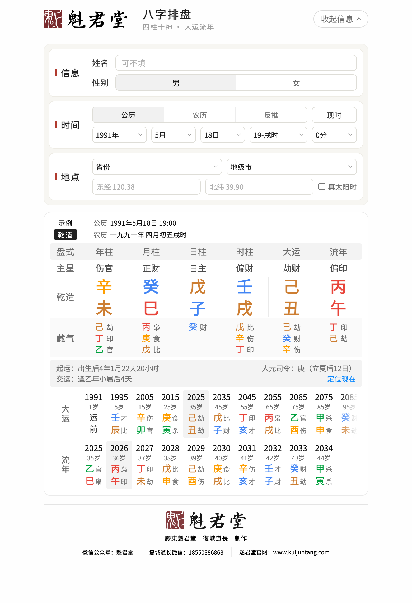

# 八字排盘 · bazi-paipan

> 给一个出生时刻与性别，出一张**按命书版式逐格对齐**的八字盘。
> 产出的 HTML 不是死图，而是一个能用的排盘器——断网双击即开，改任一项即自动重排。

支持公元 **600–2100（隋至清）**；大运**十二步**；建国前（≤1949）点到流年即显「明·万历十五年」这类**年号纪年**；
可勾**真太阳时**（给纬度则时辰走古法：日出定卯、日落定酉）。
可以用命令行出盘，也可以作为 [WorkBuddy](https://www.workbuddy.cn) 技能安装，或者——直接把产出的那个 HTML 发给别人。

本技能**只排盘，不断语**：不掺吉凶评分、不堆神煞、不给「运势结论」。它做的事是把四柱、藏干、十神、
起运交运、人元司令、大运、流年按历法与命书的规矩算准、摆正。



<sub>示例盘：乾造 辛未 癸巳 戊子 壬戌。大运条共 13 列（运前＋十二步），可点选、可横向拖动，右缘渐隐提示后续年份——图中所见为前 10 列。</sub>

---

## 在线试（无需安装）

仓库根目录的 `index.html` **就是一张排好的盘**（示例：乾造 辛未 癸巳 戊子 壬戌）。
在 GitHub 仓库设置里把 Pages 指向 `main` 分支根目录，即可获得一个可在线改生辰的演示页；
也可以直接下载这个文件，双击打开，断网可用。

## 三十秒上手

```bash
# 1) 命令行出盘（Python 3.8+，仅标准库，无需 pip install）
python3 scripts/paipan.py --birth "1991-05-18 19:00" --gender male --fixed --out ./out

# 2) 产物是一对同名文件
#    out/八字排盘.html   ← 单文件、零外链、约 242 KB，双击即用
#    out/八字排盘.md     ← 文本形态，四柱／藏气／大运／流年逐表对应
```

```bash
# 按真太阳时（给经度；再给纬度则时辰走古法）
python3 scripts/paipan.py --birth "1991-05-18 19:20" --gender male \
        --lon 120.38 --lat 36.07 --place 青岛市 --true-solar --out ./out

# 历史人物（1582-10-15 前按儒略历填写；年号由界面显示，不需换算）
python3 scripts/paipan.py --birth "0730-06-15 10:00" --gender male --name 唐·某 --fixed --out ./out
```

作为 WorkBuddy 技能安装：

```bash
unzip 八字排盘-技能包-v3.1.1.zip -d ~/.workbuddy/skills/   # 解出 skills/bazi-paipan
```

> 目录名不参与任何计算：叫 `bazi-paipan` 或 `八字排盘` 都能跑，技能列表显示的名字取自 `SKILL.md` 的 `name` 字段。

## 盘面有什么

| 区块 | 内容 |
| --- | --- |
| 顶栏 | 魁君堂标 ＋ 标题 ＋「收起／展开信息」 |
| 四柱 | 年、月、日、时 四柱干支，大字五行配色 |
| 主星 | 四柱天干十神（当前所选大运、流年同列） |
| 藏气 | 每支藏干（本气→余气）＋ 单字十神，**整组**居中于本柱中轴 |
| 起运／交运 | 「出生后 N 年 M 月 D 天 H 小时」「逢某年某节后 N 天」 |
| 人元司令 | 按交节后日数取当月司令（如「庚（立夏后 12 日）」） |
| 大运 | 运前 ＋ **十二步**，共 13 列，可点选、可横拖，右缘渐隐提示 |
| 流年 | 当前大运所辖十年，当年高亮；**≤1949 时整行中线显年号纪年** |
| 录入 | 三节（信息／时间／地点）各两行：姓名·性别｜公历·农历·反推·现时 ＋ 年月日时分｜省→市（34 省级 / 348 市，经纬自动填）＋ 真太阳时 |

## 和网上在线排盘不一样的地方

这一节是重点。下面每一条都不是「多做了一个小功能」，而是**口径或取舍上刻意与常见做法分道**。
「常见做法」一列按公开在线排盘工具的一般形态归纳，不针对任何具体产品；凡涉及数值差异的，都以可复跑的脚本为准。

### 一、算法与历法

| 事项 | 本技能 | 常见在线排盘 |
| --- | --- | --- |
| 年份范围 | **600–2100**，1582-10-15 前自动走**儒略历**；600–1899 节气用 Meeus 太阳视黄经回推＋ΔT | 多数只做 1900 年以后，或古代年份直接给「估算」 |
| 均时差 | **Meeus 28.1 天文法**（与节气回推同一套太阳视黄经），8 个天文年历锚点误差 ≤0.12 分 | 多沿用 `9.87sin2B−7.53cosB−1.5sinB` 简化式，唐代偏差可达 **2.8 分钟** |
| 真太阳时 | 北京时间 ＋ 经度差×4 分 ＋ **Meeus 均时差**；经度可按 348 市自动填，也可手改 | 常只做「经度差×4 分」，不做均时差 |
| 古法时辰 | 勾真太阳时且给纬度：**日出定卯初、日落定酉初，昼夜弧各六等分**，日界＝真太阳子夜 | 几乎不做，一律按钟点切时辰 |
| 日界 | **子时换日：23:00 起即算次日**（`--no-late-zi` 可改回 00:00） | 说法不一，多数含糊或按自然日 |
| 大运 | **十二步**（含「运前」共 13 列），起运按「3 日折 1 年、1 日折 4 月、1 月折 30 日」逐级折算 | 多数十步，且只给年份不给交运时刻 |
| 运前流年 | 「运前」列**只列出生年至起运前一年**，起运之后留空 | 多数把流年一律铺满，运前运后不分 |
| 藏干十神 | 藏干与日干同五行同阴阳者一律「**比肩**」；「日主」**只属于日柱天干** | 常见把藏干里的同类干误标「日主」 |
| 人元司令 | 按**交节后日数**落段取司令（分野表见 `references/口径与表格.md`） | 多数不排，或只给当月本气 |
| 农历 | 数据 600–2100（1501 年），**录入**限 1900–2100——古代只显示、不作输入 | 常见只做 1900 年后，或古代农历无出处 |
| 反推生辰 | 只知四柱时，按**候选时刻**判年柱月柱（交节落在时辰内也能命中），60 日循环步进 | 多按当日正午粗判，交节附近的解会漏 |
| 年号纪年 | 年号表 **193 条**，自隋·开皇元年（581）；≤1949 的盘点到流年即显该年年号 | 几乎没有 |

### 二、盘面与版式

| 事项 | 本技能 | 常见在线排盘 |
| --- | --- | --- |
| 版式 | 按命书版式**逐格对应**：盘式｜年柱月柱日柱时柱｜大运｜流年，主星、藏气、起运、交运、司令各行位置固定 | 多为卡片式排版，信息分组随意 |
| 藏气对齐 | 藏干字与十神简称视为**一组**，整组居中于本柱中轴（实测六列偏差 0.0） | 多以「字」为对齐单位，十神随列宽浮动，整块重心容易偏 |
| 字色 | 五行配色（木 #01A13E／火 #E8443A／土 #CD7E32／金 #FE9E00／水 #4285F4），全站黑体（思源优先） | 常见宋体＋单一色 |
| 打印 | `Ctrl/⌘+P` 直接出成品 PDF：录入面板隐藏、13 列全展开不裁切 | 常需另做「打印页」或只能截图 |

### 三、交互取舍（做过减法）

| 事项 | 本技能 | 常见在线排盘 |
| --- | --- | --- |
| 重排 | **没有「排盘」按钮**：改任一项，90ms 防抖后自动重排 | 填完点按钮 |
| 录入区 | 三节各成一块白卡，每节两行；节标题留最左列、对右列纵向居中；行自列左起、控件吃满右缘，**两头都不留白** | 常见表单堆叠、留白随意 |
| 已删功能 | 姓名历史、十二位文本黏贴识别、±10 年、五列滚轮，**一律不做**（写回即算缺陷） | 越堆越多 |
| 部署 | **单文件自包含**：CSS／数据／城市表／JS／logo 全内联，零外链（唯一外链是底部进官网的 `<a>`），断网可跑 | 依赖 CDN、字体、接口 |

### 四、工程与可验证性

| 事项 | 本技能 |
| --- | --- |
| 双内核 | Python（`scripts/bazi_core.py`）与前端（`assets/app.js`）两套独立实现，**8 字段逐例对拍**（四柱／主星＋藏干十神／起运／交运／司令／大运／流年／选中） |
| 第三方复核 | 另写一套「独立口径」脚本：四柱取 [sxtwl](https://github.com/yuangu/sxtwl_cpp)，十神／藏干／大运全部另写，**600 例随机 0 差异** |
| 穷举核验 | 日柱 **73414 天**、年月柱 9648 例、节气 4824 项、农历往返 10884 天，全部 0 错 |
| 交付自检 | `check.py` **56 项**（结构／几何／交互／打印安全／十神口径／反推·年号·换省）＋ 界面探针 17 项（含真 320px 窄屏） |
| 缺陷台账 | 作者侧另存 106 条缺陷台账，每条含「现象·根因·处理·验证·影响范围」，改版逐条复查——本仓库只发布结论与代码 |

## 这些规矩是怎么来的

这个技能的第一条要求是「**严格按图示格式与 UI 布局**」。它从一张截图开始，之后每一条都记了号、
写进了作者侧的指令存档，也逐条落到代码与断言里。几条比较特别的：

- **藏干整组对中轴**：不是把藏干字居中就完事——字与十神是一组，整组对本柱中轴，实测六列偏差 0.0。
- **录入区不留白**：既不左留白也不右留白；整组右推会留行首空白，定宽会留行尾空白，两个都试过、都被否掉。
- **禁 CSS `mask`**：`mask` 类属性在 Chrome 打印／导出 PDF 时会渲染成实心黑块，横条渐隐一律改「绝对定位伪元素＋单色渐变」，打印时隐藏。
- **宽度都加上限**：`min(…, 100%)`，否则窄屏必出横向滚动条。
- **下拉不许遮字**：右内边距留出箭头区，宽度按最坏文案算——这类毛病复发过四回，所以进了自检。

这些细节没有一条来自「网上都这么做」，全部来自逐轮实拍、量测、返工。

## 能拿来干什么

**个人与教学**

- 排自己的盘、家人的盘，看四柱、藏干十神、起运交运、当前大运流年。
- 讲八字基础：藏干怎么排、十神怎么定、人元司令怎么分野、大运怎么起——盘面信息齐，一屏讲完。
- 讲「真太阳时」到底差多少：同一时刻换个城市，看出生时辰是否越界。
- 打印成 PDF 归档，或作为纸质命书的底稿。

**古籍与历史人物**

- 给历史人物排盘：输入公历（1582 年前按儒略历填写），界面直接显「明·万历十五年」这类年号，不必自己换算。
- 校勘古籍里的生辰记载：把原文日期转四柱，与书中记载的干支对照，不一致处即校勘线索。
- 研究节气与命书的关系：交节前后一分钟出生，年月柱会换——本盘按**精确交节时刻**判，可用来核对「按日换柱」类记载的误差。

**内容创作**

- 出图：单文件 HTML 打开即排版完整，截图即可用于文章、课件、公众号。
- 只知四柱要反推生辰（如古籍只留八字），列出候选时刻逐个核对。
- 做「同一天不同时辰」的对比素材，直观展示时柱与藏干十神的变化。

**工程集成**

- 当 Python 库用：`scripts/bazi_core.py` 可单独 import，出四柱、十神、藏干、司令、大运、流年，无需渲染。
- 批量出盘：脚本循环调用 `paipan.py`，产出 MD 做统计（如某朝代人物的月支分布、起运年龄分布）。
- 断网／内网环境：单文件零外链，拷进离线机器双击即用。
- 当模板改：尺寸全走 `--u` 一个变量，五行色是 `--mu/--huo/--tu/--jin/--shui` 五个变量——改字号栏宽或换主题，都只动这两处。

## 命令与参数

| 参数 | 作用 |
| --- | --- |
| `--birth "YYYY-MM-DD HH:MM"` | 出生时刻（北京时间）；不给则取运行此刻 |
| `--fixed` | 页面固定为该生辰；不加则「打开即此刻」 |
| `--gender male\|female` | 男＝乾造，女＝坤造，并定大运顺逆 |
| `--name` / `--place` | 姓名／出生地，仅显示用 |
| `--lon` / `--lat` | 东经／北纬；给纬度则时辰走古法 |
| `--true-solar` | 启用真太阳时校正 |
| `--no-late-zi` | 23:00 后不换日（默认换日） |
| `--now` / `--focus N` | 以指定日期作「现在」／默认定位到第 N 年 |
| `--out` | 输出目录（默认 `./out`），建议写绝对路径 |

## 口径与已知边界（不藏着）

- **农历录入限 1900–2100**：数据本身到 600 年，但古代行用《麟德历》《大衍历》等，朔望与今不同，故古代只显示、不作输入。
- **689–700、761–762 共 14 年**：因底表年边界错位，月日为近似（年份与年号仍正确，且不污染其他年份）。
- **1986–1991 夏令时**：未内置回拨，需自行换算后再入参。
- **示例盘的出生时刻**：由起运时长倒推为 19:00，非原盘实值。
- **「逢乙、庚年」**：按实算推不出庚，本技能只出「乙」。
- **只排盘不断语**：不含吉凶判断与神煞；命理内容属传统文化，仅供研究、教学与个人参考，不构成任何预测或决策建议。

更细的取值口径见 [`references/口径与表格.md`](references/口径与表格.md)（节气、藏干、十神、人元司令、大运折算的唯一说明处）。

## 项目结构

```
README.md  LICENSE  CHANGELOG.md  preview.png
index.html                  在线演示（示例盘快照，可直接当 GitHub Pages 首页）
SKILL.md                    技能说明书（WorkBuddy 读取的入口）
scripts/paipan.py           命令行入口：出 HTML ＋ MD
scripts/bazi_core.py        Python 内核：历法／干支／十神／藏干／司令／真太阳时／古法／大运
scripts/render.py           组装单文件 HTML（内联 css/data/cities/js/logo）与 MD
scripts/jieqi_data.py       1900–2112 节气表（生成物，勿手改）
assets/app.css              样式（含 @media print）
assets/app.js               前端：历法内核 ＋ 盘面渲染 ＋ 录入交互
assets/data.js              节气（1900–2112）／农历（600–2100）表（生成物，勿手改）
assets/cities.js            34 省级 ＋ 348 市（含驻地经纬度）
assets/logo.b64             魁君堂标（PNG base64，内联用）
references/口径与表格.md      口径唯一说明处
devtools/build|verify|probe 建表、校验、探针（开发用；不在技能包内，随仓库提供）
out/                        示例产物（HTML ＋ MD）
dist/                       可分发技能包 zip（11 个文件）
```

> 装进 WorkBuddy 只需要 `SKILL.md` ＋ `scripts/` ＋ `assets/` ＋ `references/` 这 11 个文件；
> 仓库里其余的都是给人看的、给人验的。

## 自检（可复跑）

只依赖 Python 与（部分脚本）Chrome／node／sxtwl。`check.py` 的运行时项要 Chrome，未装则只跑静态段、
总项数对不上会自报失败——这是有意为之，不假装通过。

```bash
python3 devtools/verify/check.py ./out          # 产物自检 56 项
python3 devtools/probe/audit_probe.py           # 内核探针 18 项
node    devtools/probe/audit_probe_js.js        # 前端探针 7 项（需 node）
python3 devtools/probe/audit_probe_ui.py ./out/八字排盘.html   # 界面／打印探针 17 项（需 Chrome）
python3 devtools/verify/validate_core.py        # 现代全量（需 sxtwl）
python3 devtools/verify/validate_ancient.py     # 古代 600–1899（需 sxtwl）
python3 devtools/verify/verify_lunar.py         # 农历往返 10884 天（需 sxtwl）
python3 devtools/verify/verify_js.py 300        # 双内核 8 字段对拍（需 node）
python3 devtools/verify/verify_independent.py 600   # 独立口径复核（需 sxtwl）
```

仓库形态下 `devtools/paths.py` 自动以仓库根为技能目录，`clone` 后不必设环境变量；
若技能装在别处，用 `BAZI_SKILL=/path/to/bazi-paipan` 覆盖。

## 许可

**MIT License** —— 只保留**署名**（保留版权声明与许可声明），其余权利一概不保留：
可商用、可修改、可再分发、可闭源集成，无需另行授权。全文见 [LICENSE](LICENSE)。

数据与算法来源见文末致谢；排盘结果的解读与使用由使用者自负。

## 作者

**膠東魁君堂　復城道長**
微信公众号：魁君堂　｜　微信：18550386868　｜　官网：<https://www.kuijuntang.com/>

## 致谢

- [sxtwl_cpp / 寿星天文历](https://github.com/yuangu/sxtwl_cpp)（MIT）：生成节气与农历底表，并用作独立口径复核的第三方对照。
- Jean Meeus《Astronomical Algorithms》：太阳视黄经、均时差、ΔT（Espenak–Meeus）诸式。
- [city-geo](https://github.com/88250/city-geo)：地级市驻地经纬度。
